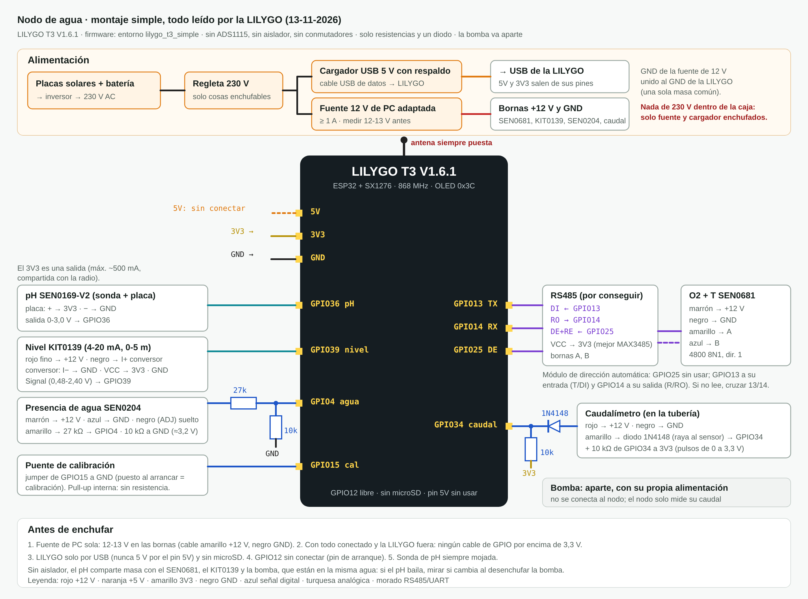
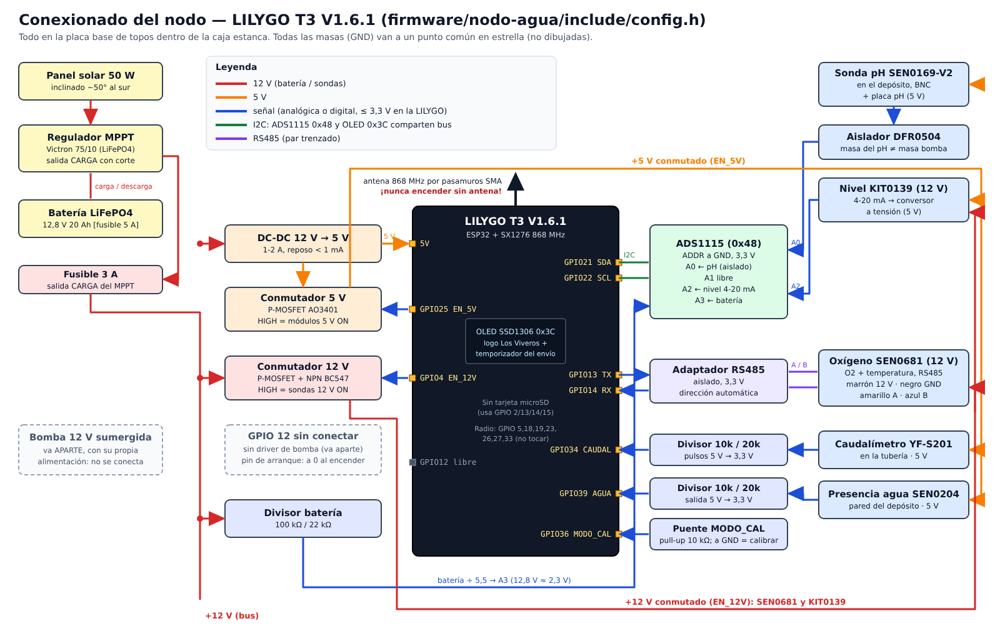
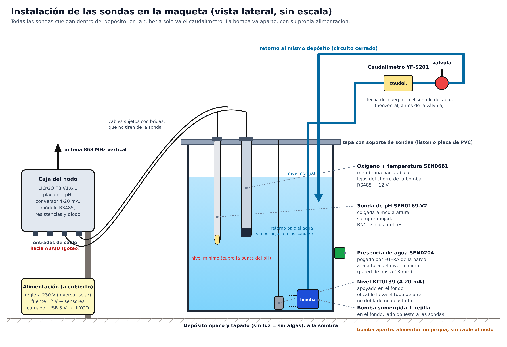

# Conexionado y montaje del nodo

## 0. Montaje que se usa de verdad: todo leído por la LILYGO (13-11-2026)



(Editable: `img/conexionado-simple.svg`. Firmware: entorno `lilygo_t3_simple`.)

Material que hace falta además de los sensores, la LILYGO, la Raspberry y la gateway: una fuente de 12 V de PC
adaptada (≥ 1 A), un cargador USB de 5 V con batería de respaldo, resistencias (27k, 2 × 10k), un diodo 1N4148
y un módulo RS485 a TTL de 3,3 V (MAX3485 o parecido), que está **por conseguir**. Sin el módulo RS485 no se puede
leer el SEN0681: el firmware lo marca como fallo de RS485 y usa 25 °C para compensar el pH.

| Señal | Pin LILYGO | Va a | Notas |
|---|---|---|---|
| Alimentación | USB | Cargador de 5 V con respaldo | **El pin 5V no se usa.** Por el pin 5V la batería del JST recibiría 5 V (MOSFET Si2307 del esquema T3_V1.6) |
| 3V3 | 3V3 | Placa del pH, conversor 4-20 mA, módulo RS485 | Es una salida (ME6211 de 500 mA, el mismo que la radio) |
| GND | GND | Masa común con el negro de la fuente de 12 V | |
| pH | GPIO36 | Salida de la placa del pH (0-3,0 V) | Placa a 3V3 (admite 3,3-5,5 V, wiki SEN0169-V2). ADC1 del ESP32 |
| Nivel | GPIO39 | Signal del conversor del KIT0139 | 120 Ω: 4 mA = 0,48 V, 20 mA = 2,40 V. KIT0139 a +12 V |
| Presencia de agua | GPIO4 | SEN0204 por 27 kΩ en serie y 10 kΩ a GND | SEN0204 a +12 V: 12 V → 3,2 V. Negro (ADJ) sin conectar |
| Caudal | GPIO34 | YF-S201 por diodo 1N4148 (raya hacia el sensor) + 10 kΩ de GPIO34 a 3V3 | YF-S201 a +12 V. Vale tenga la salida que tenga |
| Calibración | GPIO15 | Puente a GND | Pull-up interna, sin resistencia |
| RS485 | GPIO13 / GPIO14 / GPIO25 | DI / RO / DE+RE del módulo | Con módulo de dirección automática, GPIO25 sin usar. Si no lee, cruzar 13 y 14 (no se rompe nada) |

Por qué así (comprobado en el esquema oficial `T3_V1.6.1.pdf` de LilyGO y en las wikis de DFRobot):
- El SEN0204 pide 5-24 V y por USB el pin 5V da ~4,7 V (diodo BAT20J), por eso va a 12 V.
- El YF-S201 no dice en su ficha qué salida tiene: con un divisor podría no llegar a los 2,48 V que el ESP32 lee como "1".
  Con el diodo y la pull-up a 3,3 V funciona siempre.
- Sin aislador, el pH comparte masa con el resto de sensores del depósito: si baila, probar desenchufando la bomba.

El resto de este documento es el diseño completo para la instalación final (ADS1115, aislador, conmutadores y solar).

## Diseño completo (instalación final)

> Pines de la LILYGO según `firmware/nodo-agua/include/config.h`, sacados del `utilities.h` oficial de LilyGO
> (https://github.com/Xinyuan-LilyGO/LilyGo-LoRa-Series). **Verificar con la placa exacta antes de soldar nada.**
> Los de abajo son para la T3 V1.6.1 (SX1276).



(El dibujo se puede editar: `img/conexionado-nodo.svg`.)

## 1. Idea general: no soldar los sensores a la LILYGO

Todo va sobre una **placa base de topos** dentro de la caja estanca:
- La LILYGO va **pinchada en tiras de pines hembra**, no soldada. Si se rompe, se cambia en 1 minuto.
- Los módulos Gravity (placa del pH, aislador, ADS1115) se conectan con sus
  **cables PH2.0 de 3 pines** a tiras de pines macho soldadas en la placa base.
- Alimentación, RS485 y cables largos entran por **bornas de tornillo**.
- Los sensores exteriores entran por **conectores de aviación GX12/GX16** en la pared de la caja
  y la sonda de pH por **pasamuros BNC**. Así se desmonta un sensor sin abrir la caja.
- Lo único que se suelda es la placa base (pines, bornas, MOSFET de los conmutadores, resistencias, puentes).
- **La bomba va aparte**, con su propia alimentación (decisión de 2026-10-26): no se conecta al nodo.
  La LILYGO solo mide el caudal que da.

## 2. Esquema de bloques

```
 Panel 12V ──► Regulador MPPT ◄──► Batería LiFePO4 12,8 V
                    │ salida CARGA
                  [F 3A]
                    ├──────────────► DC-DC 12→5 V ──► LILYGO 5V/VBUS  (siempre)
                    │                                   └─ 3V3 ──► ADS1115 (siempre, 3,3 V)
                    ├──[conmutador 12V, GPIO EN_12V]──► SEN0681 (oxígeno) 10-30 V
                    │                                  └► KIT0139 (nivel 4-20 mA)
                    └──[divisor 100k/22k]──────────────► ADS1115 A3 (batería)

  DC-DC 5 V ──[conmutador 5V, GPIO EN_5V]──► placa pH ──► aislador ──► ADS1115 A0
                                          ├► convertidor 4-20 mA ────► ADS1115 A2
                                          ├► adaptador RS485 (lado aislado lo alimenta él)
                                          ├► SEN0204 (presencia de agua) ──[divisor 10k/20k]──► GPIO AGUA
                                          └► Caudalímetro ──[divisor 10k/20k]──► GPIO CAUDAL

  Bomba 12 V: alimentación propia, sin conexión con el nodo (GPIO 12 libre)
```

## 3. Tabla de conexiones (LILYGO T3 V1.6.1)

| Señal | Pin LILYGO | Va a | Notas |
|---|---|---|---|
| 5 V entrada | 5V / VBUS | Salida DC-DC 5 V | No conectar USB y 5 V externo a la vez sin revisar el esquema de la placa |
| GND | GND | Masa común (punto estrella en la placa base) | |
| I2C SDA | GPIO 21 | ADS1115 SDA | Compartido con la OLED de la placa (0x3C). ADS1115 en 0x48 |
| I2C SCL | GPIO 22 | ADS1115 SCL | |
| RS485 TX | GPIO 13 | Adaptador RS485 RX(D) | UART2 |
| RS485 RX | GPIO 14 | Adaptador RS485 TX(D) | |
| EN_12V | GPIO 4 | Base del NPN del conmutador 12 V | HIGH = sensores 12 V encendidos |
| EN_5V | GPIO 25 | Puerta/driver del conmutador 5 V | HIGH = sensores 5 V encendidos (el LED de la placa también parpadea) |
| AGUA | GPIO 39 | Salida SEN0204 por divisor 10k/20k | Solo entrada. La salida del SEN0204 en alto vale lo mismo que su alimentación (5 V, wiki DFRobot SEN0204), así que lleva el mismo divisor que el caudalímetro: 10 kΩ en serie y 20 kΩ de GPIO 39 a GND (≈3,3 V). Sin pull-up |
| MODO_CAL | GPIO 36 | Puente a GND | Solo entrada; pull-up externa 10 kΩ. Puente puesto al arrancar = modo calibración |
| (libre) | GPIO 12 | Nada | La bomba va aparte y ya no se controla desde el nodo. GPIO 12 es pin de arranque y tiene que estar a 0 al encender: se deja sin conectar |
| CAUDAL | GPIO 34 | Salida del caudalímetro por divisor 10k/20k | Solo entrada; el caudalímetro va a 5 V y sus pulsos llegan a ~3,3 V |
| Radio LoRa | 5,18,19,23,26,27,33 | Internos | No usar |
| Antena | Conector u.FL/SMA | Pigtail a pasamuros SMA | **Nunca encender sin antena** |
| OLED | Interna (I2C 21/22, 0x3C) | — | Ya viene en la placa. Muestra el logo de Los Viveros, la fase del ciclo y el temporizador del envío LoRa |

**No poner tarjeta microSD en la LILYGO.** En la T3 V1.6.1 el lector de tarjetas usa los GPIO 2, 13, 14 y 15
(`utilities.h` de LilyGO) y nosotros usamos el 13 y el 14 para el RS485.

### ADS1115 (dirección 0x48, ADDR a GND)
| Canal | Señal | Rango esperado |
|---|---|---|
| A0 | pH (tras aislador) | 0-3 V |
| A1 | Libre (antes conductividad) | — |
| A2 | Nivel (convertidor 4-20 mA) | ~0,48-2,4 V (4-20 mA en 120 Ω, verificar) |
| A3 | Batería (divisor 100k/22k) | 12,8 V → ~2,3 V |

Ganancia `GAIN_ONE` (±4,096 V). Nunca meter más de VDD+0,3 V (3,6 V) en una entrada.

### SEN0681 (oxígeno) — colores del cable
| Cable | Función | Va a |
|---|---|---|
| Marrón | VCC 10-30 V | Salida del conmutador 12 V |
| Negro | GND | Masa |
| Amarillo | RS485 A | Borna A del adaptador |
| Azul | RS485 B | Borna B del adaptador |

## 4. Conmutador de 12 V (lado alto), para soldar en la placa base
```
 +12V ───┬──────────── S  P-MOSFET (IRF9540N / AOD417)
         │                D ──────► +12V_SENSORES
        [10k]           G
         │               │
         └───────────────┤
                         C  NPN (BC547 / 2N2222)
 GPIO EN_12V ──[1k]──── B
                         E ── GND
```
GPIO en HIGH → NPN conduce → puerta a masa → MOSFET conduce. Añadir 100 kΩ de base a masa
para que al arrancar el ESP32 los sensores queden apagados. El de 5 V es igual con un P-MOSFET
de nivel lógico (AO3401).

## 5. Bomba

La bomba va **aparte, con su propia alimentación**, y está fuera del sistema del nodo (decisión de 2026-10-26).
No hay MOSFET, ni diodo, ni pull-down en la placa base, y el GPIO 12 queda libre. El nodo solo mide el caudal
con el caudalímetro: si al medir no hay caudal (bomba apagada, atascada o sin agua) se marca el aviso
"bomba sin caudal" del payload (`docs/04-formato-payload.md`).

## 6. Buenas prácticas del montaje
- Masa en estrella: todas las masas llegan a un punto; la sonda de pH lejos del DC-DC.
- Sonda de pH siempre mojada: se puede apagar su placa, pero la sonda no puede secarse.
- Cables de sondas separados de los de 12 V; RS485 con par trenzado.
- Membrana de ventilación en la caja (evita condensación) y bolsitas de gel de sílice.
- Barniz protector (conformal coating) sobre la placa base una vez probada.
- Etiquetar cada cable en los dos extremos.
- Sondas colgadas del soporte dentro del depósito, con el cable sujeto para que no tire del conector.

## 7. Instalación física de las sondas en el depósito



| Sensor | Dónde va | Cómo se sujeta | Ojo con |
|---|---|---|---|
| pH SEN0169-V2 | Colgado del soporte de la tapa, a media altura, lado contrario a la bomba | Prensaestopas o abrazadera en el soporte; la punta siempre por debajo del nivel mínimo | Nunca dejarlo en seco. Cable BNC sin tensión |
| Oxígeno SEN0681 | Colgado junto al pH, membrana hacia abajo | Igual que el pH | Lejos del retorno y de la bomba (las burbujas falsean el O2) |
| Nivel KIT0139 | Apoyado en el fondo | Colgado de su propio cable hasta tocar fondo | El cable lleva un tubo de aire dentro: no aplastarlo ni doblarlo fuerte; el extremo del cable, dentro de la caja seca |
| Bomba 12 V (alimentación aparte) | En el fondo, lado contrario a las sondas | Con su rejilla de aspiración | Que no aspire lodo: un par de cm por encima del fondo si tiene patas. Su cable no entra en la caja del nodo |
| Presencia de agua SEN0204 | Pegado por fuera de la pared del depósito, a la altura del nivel mínimo | Cinta de doble cara o adhesivo | Detecta a través de una pared de hasta 13 mm (wiki DFRobot SEN0204: "thickness of induction 0 ~ 13 mm"); sin metal cerca |
| Caudalímetro YF-S201 | En la tubería de salida, horizontal, antes de la válvula | Racores de espiga 1/2" | La flecha del cuerpo en el sentido del agua |

Los cables salen de la caja 1 por los prensaestopas y conectores GX16, **siempre hacia abajo** para que el agua
de lluvia gotee y no entre. Etiquetar cada conector con el nombre del sensor.
