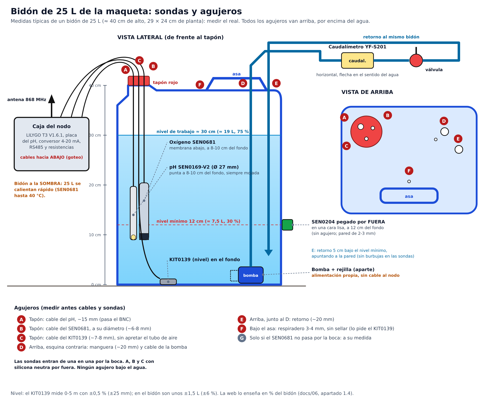

# Maqueta exterior

## 1. Qué es
Depósito con agua de red con **todas las sondas colgadas dentro**, una bomba sumergida que mueve el agua
en circuito cerrado (sale por la tubería, pasa por el caudalímetro y vuelve al mismo depósito), y el
nodo LILYGO en una caja estanca. No hay cámara de medida aparte. El nodo y los sensores van alimentados con un
panel solar y una batería. **La bomba va aparte** (decisión de 2026-10-26): tiene su propia alimentación, no se
conecta al nodo y el nodo no la enciende ni la apaga; solo mide el caudal que da.
Está fuera del edificio; la telemetría entra al centro por LoRaWAN hasta el gateway.

El depósito es un **bidón azul de plástico de 25 L** con tapón rojo de rosca y asa (2026-11-17, apartado 1.1).
Todos los agujeros van **arriba**, por encima del agua, para que no pueda haber fugas.

### 1.1. El bidón de 25 L

Datos del bidón (marcado en relieve `3H1/X1.5-Y1.9/250/16 E/02-J-431-11/AA3`): es un envase homologado ONU para
mercancías peligrosas: **3H1** = bidón (jerricán) de plástico con tapón fijo, **X/Y** = homologado para líquidos
peligrosos de densidad hasta 1,9, **250** = presión de prueba en kPa, **16** = fabricado en 2016, **E** = España.
Es polietileno grueso y opaco (bien contra las algas), pero **seguramente ha llevado algún producto químico**:
antes de usarlo, enjuagarlo varias veces con agua y dejarlo un día lleno de agua, y medir el pH de esa agua con el
SEN0161-V2 de laboratorio. Si el pH no es el del grifo, quedan restos: repetir el lavado.

Medidas: el bidón no las trae marcadas. Mientras no se midan se usan las típicas de un bidón de 25 L
(**TODO VERIFICAR** con el metro y el calibre):

| Medida | Valor supuesto | Para qué se usa |
|---|---|---|
| Alto del cuerpo (sin tapón) | ~40 cm | 100 % del nivel en la web (`BIDON.alturaLlenoMm` en `raspberry/web/static/app.js`) |
| Planta | ~29 × 24 cm (por dentro ~27 × 22,5 cm) | ~0,6 L por cada cm de agua |
| Boca (por dentro) | ~45-50 mm | Por ella entran las sondas una a una |
| Pared | 2-3 mm | El SEN0204 detecta a través de hasta 13 mm (wiki DFRobot SEN0204) |

Las sondas no se meten a la vez, se meten **de una en una por la boca** y luego solo salen sus cables por el tapón.
Tamaño de cada una:

| Sonda | Diámetro | ¿Pasa por la boca? |
|---|---|---|
| pH SEN0169-V2 (electrodo industrial) | 27,4 mm, 177 mm de largo con la funda (wiki DFRobot FIT0348) | Sí |
| Oxígeno SEN0681 | La wiki no da la medida (solo un plano en imagen) | **TODO VERIFICAR** con el calibre. Si es más gorda que la boca, hacer un agujero G aparte (ver abajo) |
| Nivel KIT0139 | La wiki no da la medida | **TODO VERIFICAR**. Las sondas de este tipo suelen tener unos 26-28 mm, así que debería pasar |
| Bomba | Depende del modelo | **TODO VERIFICAR**. Si no pasa por la boca, hacer un agujero en la parte de arriba a su medida |

### 1.2. Agujeros del bidón

Bidón de pie, con el tapón arriba. Ningún agujero en las paredes ni por debajo del agua.

| Agujero | Dónde | Tamaño | Para qué |
|---|---|---|---|
| A | Tapón rojo | Lo justo para que pase el conector BNC (~15 mm) | Cable de la sonda de pH |
| B | Tapón rojo | Al diámetro del cable (medirlo, ~6-8 mm) | Cable del SEN0681 (RS485 + 12 V) |
| C | Tapón rojo | Al diámetro del cable (~7-8 mm) | Cable del KIT0139 (lleva dentro el tubo de aire: no apretarlo) |
| D | Arriba, en la esquina contraria a la boca (en diagonal) | Al diámetro exterior de la manguera de la bomba (~19-20 mm con la de 13 mm por dentro) + uno pequeño para su cable | Salida de la bomba hacia el caudalímetro |
| E | Arriba, al lado del D | Igual que el D (~20 mm) | Retorno: la manguera entra hasta 5 cm por debajo del nivel mínimo, apuntando a la pared, para que no haga burbujas en las sondas |
| F | Arriba, debajo del asa (protegido de la lluvia) | 3-4 mm | Respiradero. **Hace falta**: el KIT0139 mide la presión del agua contra la del aire de fuera (por su tubo de aire). Si el bidón queda cerrado del todo, el aire de dentro se calienta al sol, empuja y el nivel sale mal |
| G (solo si hace falta) | Arriba, al lado de la boca | Diámetro de la sonda + 1 mm | Solo si el SEN0681 no pasa por la boca |
| — | Pared exterior lisa, a 12 cm del fondo | Sin agujero | SEN0204 pegado por fuera (presencia de agua = nivel mínimo) |

Cómo hacerlos: broca escalonada o corona para plástico, a pocas vueltas para no derretir el polietileno. Después,
pasar los cables, sujetar cada sonda a su altura con una brida por dentro del tapón, y sellar los agujeros A, B y C
con silicona neutra por fuera (que la lluvia no entre por el tapón). El respiradero F no se sella.

### 1.3. Alturas de las sondas (desde el fondo del bidón)

| Qué | Altura | Litros (con ~0,6 L/cm) |
|---|---|---|
| KIT0139 | Apoyado en el fondo (0 cm) | — |
| Punta del pH y membrana del SEN0681 | 8-10 cm | ~5-6 L |
| **Nivel mínimo** (SEN0204 por fuera) | **12 cm** | **~7,5 L (30 %)** |
| Nivel de trabajo (rellenar hasta aquí) | ~30 cm | ~19 L (75 %) |
| Lleno (no llenar más: el aire de arriba hace falta para el respiradero) | ~40 cm | 25 L |

La sonda de pH y el SEN0681 cuelgan juntos cerca de la boca; la bomba y el retorno quedan en la otra punta del
bidón. Con solo 25 L todo está cerca: que el retorno no apunte a las sondas.

### 1.4. Resolución del nivel en el bidón

El KIT0139 mide de 0 a 5 m y el bidón tiene unos 40 cm, así que solo se usa el 8 % de su rango:

| Paso | Cálculo | Resultado |
|---|---|---|
| Corriente por mm | 16 mA / 5000 mm | 0,0032 mA/mm |
| Tensión por mm (resistencia de 120 Ω del conversor) | 0,0032 mA × 120 Ω | 0,384 mV/mm |
| Señal con el bidón vacío y lleno | 4,00 mA → 480 mV; 5,28 mA → 634 mV | solo ~154 mV de margen en todo el bidón |
| Error del sensor (0,5 %, wiki DFRobot KIT0139, sobre 5 m) | 0,005 × 5000 mm | **±25 mm ≈ ±1,5 L ≈ ±6 %** |
| Paso del ADC del ESP32 con 11 dB | ~0,8 mV | ~2 mm |
| Paso del ADC con 2,5 dB (lo que usa ahora el firmware) | ~0,3 mV | <1 mm |

Conclusión: lo que limita es el sensor, no el ADC. El nivel sirve para ver si el bidón se vacía, si se evapora
agua o si alguien lo ha rellenado, pero no para medir litros finos. Por eso:
- **Firmware** (`lilygo_t3_simple`): el pin del nivel pasa a 2,5 dB de atenuación (rango 100-1250 mV, de sobra
  para el bidón) y hay un ajuste del cero `NIVEL_CERO_MM` en `config.h`. El mensaje LoRaWAN no cambia: sigue
  mandando el nivel en mm.
- **Web**: la tarjeta del nivel enseña el **% del bidón sin decimales** y debajo los litros y los mm. 30 % o menos
  sale en rojo (agua cerca de la punta del pH) y menos del 50 % en "Vigilar". El CSV sigue en mm.

**Calibración del nivel** (10 minutos, con el monitor serie en modo calibración y el comando `leer`):
1. Bidón vacío con el KIT0139 en el fondo: apuntar `nivel=`. Ese valor va en `NIVEL_CERO_MM` y se graba otra vez.
2. Echar agua de 5 en 5 L (con una garrafa de 5 L) y apuntar el nivel en cada paso: 5, 10, 15, 20 y 25 L.
3. Con la tabla, corregir `BIDON.alturaLlenoMm` (mm que marca con 25 L) en `raspberry/web/static/app.js`.
   Si la tabla no sale recta (el bidón se estrecha arriba), apuntarlo en la memoria como limitación.

## 2. Funcionamiento en cada ciclo (cada 15 min)
La bomba, que va aparte, es la que mueve el agua para que las sondas no vean agua estancada. El nodo:
1. Se despierta, enciende los sensores y hace el join (o recupera la sesión LoRaWAN).
2. Espera 60 s a que se calienten los sensores (el SEN0681 tarda hasta 60 s en dar un valor estable).
3. En los últimos 10 s de esa espera mide el caudal. Si es menor de 0,3 L/min → aviso "bomba sin caudal"
   (la bomba está apagada, atascada o sin agua).
4. Lee todos los sensores, los apaga, envía el mensaje y se duerme.

## 3. Balance de energía (estimación, se confirma midiendo en la fase 6)

| Consumo | Cálculo | Wh/día |
|---|---|---|
| SEN0681 (0,2 W) + KIT0139 (~0,25 W) | 60 s × 96 | 0,7 |
| LILYGO activa + placas analógicas | ~70 s × 96 a ~0,9 W | 1,7 |
| Reposo (deep sleep, DC-DC, regulador MPPT) | ~25 mA × 12 V × 24 h | 7,2 |
| DFR1120 (fase 7, reserva hasta medirlo) | — | 5 |
| **Total** | | **≈ 15 Wh/día** (se dimensiona para 20) |

La bomba no entra en la cuenta porque va aparte, con su propia alimentación.

- **Batería**: 3 días sin sol → 20 × 3 / 0,8 (descarga útil LiFePO4) = 75 Wh → **12,8 V 20 Ah (256 Wh)**, más de una semana de margen.
- **Panel**: peor mes en Sevilla (diciembre) ≈ 2,5-3 horas de sol pico. 20 Wh / (2,5 h × 0,7) ≈ 12 W,
  y ×2 para recargar tras días nublados ≈ 25 W → el **panel de 50 W** va sobrado, inclinado ~50° al sur (mejor en invierno).
- Lo que más gasta es el reposo: elegir un DC-DC y un regulador MPPT con poco autoconsumo es lo que más ahorra.

## 4. Cosas a tener en cuenta por estar al aire libre
- **Temperatura**: el SEN0681 trabaja de 0 a 40 °C. En verano en Sevilla un depósito al sol pasa de eso:
  depósito blanco u opaco, a la sombra o con toldo, y la batería LiFePO4 también a la sombra.
- **Algas**: depósito opaco y tapado; limpiar sondas cada 2-4 semanas.
- **Sondas dentro del bidón**: colgadas del tapón a 8-10 cm del fondo, lejos de la salida de la bomba
  (el chorro y las burbujas falsean el oxígeno) y por encima del fondo (lodos). El nivel mínimo (12 cm, 30 %)
  tiene que cubrir siempre la punta de la sonda de pH: si baja de ahí, alarma de rellenar.
- **Bidón pequeño al sol**: 25 L se calientan mucho más rápido que un depósito grande. El SEN0681 trabaja hasta
  40 °C, así que el bidón tiene que estar a la sombra sí o sí.
- **Evaporación**: el nivel bajará solo; es un buen dato para el panel (y para la alarma de rellenar). En el
  bidón, cada centímetro son unos 0,6 L.
- **Vandalismo y robo**: caja con candado o tornillos de seguridad, dentro de una zona vallada del centro.
- **Lluvia y rayos**: prensaestopas hacia abajo (goteo), caja con membrana de ventilación, estructura y panel a tierra si es posible.
- **Radio**: el wAP LR8 va en el mástil de la azotea del instituto (decisión de 2026-10-26), lo más alto
  posible y con visión directa a la maqueta. Detalles del montaje en `docs/02-arquitectura-red.md`.
  Medir RSSI/SNR antes de apretar las abrazaderas.
