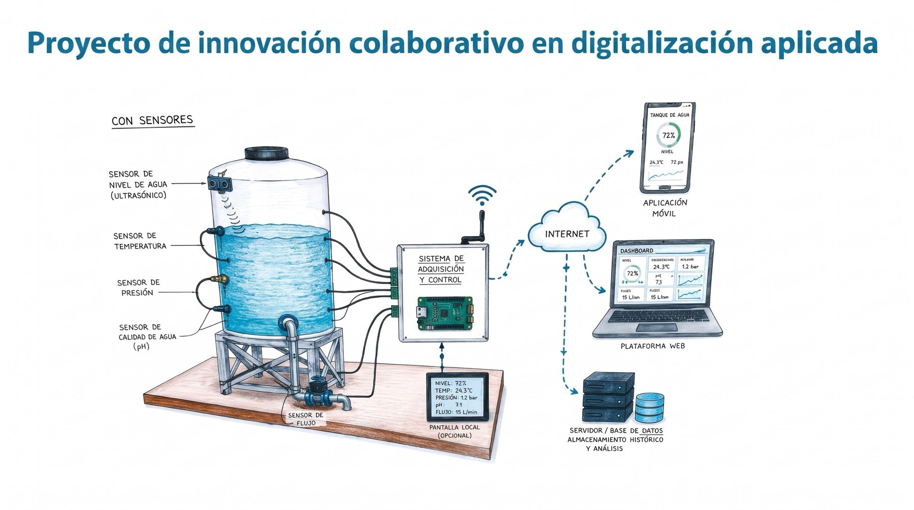

# El cartel de referencia del instituto y nuestro sistema

El instituto nos dio como punto de partida el cartel **"Proyecto de innovación colaborativo en digitalización
aplicada"**. Dibuja un depósito con sensores conectado a un sistema de adquisición y control que manda los
datos a Internet, donde se ven en una aplicación móvil y en una plataforma web y se guardan en un servidor con
base de datos.

Nuestro TFG sigue la misma idea (medir el agua de un depósito y ver los datos desde cualquier sitio), pero no es
una copia exacta: hemos montado lo que se podía con el material que tenemos y con las limitaciones de la red del
centro. Aquí se compara cada bloque del cartel con lo que hay de verdad, para que quede claro qué coincide, qué
se ha hecho de otra forma y qué no se ha hecho.

## 1. Bloque por bloque

| Bloque del cartel | Nuestro sistema | ¿Coincide? | Por qué |
|---|---|---|---|
| **Depósito** sobre una estructura, con tubería de salida | Bidón de plástico de 25 L con las sondas colgadas dentro; una bomba aparte, fuera del bidón, mueve el agua en circuito cerrado con dos mangueras (`06-maqueta.md`) | En parte | Es una maqueta pequeña con el material disponible. El agua no sale a ningún sitio, solo se recircula |
| **Sensor de nivel (ultrasónico)**, arriba del depósito | **KIT0139**: transmisor sumergible de 4-20 mA en el fondo. Mide la presión de la columna de agua y la pasa a nivel; la web lo enseña en % del bidón | El dato sí, la tecnología no | Es el sensor que tenemos. No toca el aire de arriba (condensación, tapón) y aguanta dentro del agua. Además, el **SEN0204** pegado por fuera avisa del nivel mínimo |
| **Sensor de temperatura** | La da el **SEN0681** (va en el mismo cuerpo que el oxígeno) | Sí | Una sonda menos. La temperatura también sirve para compensar el oxígeno y el pH |
| **Sensor de presión** (1,2 bar en el cartel) | **No hay** sensor de presión de tubería | No | No tenemos ese sensor. El KIT0139 mide presión por dentro, pero solo la usamos para sacar el nivel; no se enseña en bar |
| **Sensor de calidad del agua (pH)** | **SEN0169-V2**, sonda industrial de inmersión continua | Sí | — |
| **Sensor de flujo** (15 L/min en el cartel) | **No hay** caudalímetro (decisión del 2026-11-17) | No | No lo tenemos. El mensaje LoRaWAN deja el hueco del caudal como "sin dato" (`04-formato-payload.md`), así que se podría añadir sin cambiar el servidor |
| *(no sale en el cartel)* | **Oxígeno disuelto** con el SEN0681 (RS485/Modbus) | Lo añadimos | Es el parámetro que mejor dice si el agua está "viva". Es la principal aportación del TFG respecto al cartel |
| **Sistema de adquisición y control** | **LILYGO T3 V1.6.1** (ESP32 + radio LoRa SX1276) en una caja junto al bidón | Adquisición sí; control no | El nodo lee los sensores y envía, pero no controla nada: la bomba va aparte con su propia alimentación. El control por radio (relé DFR1120 activado desde el servidor) queda como ampliación (fase 7 de `CLAUDE.md`) |
| **Pantalla local (opcional)** con las medidas | Pantalla **OLED** de la LILYGO | En parte | Enseña el logo de Los Viveros, en qué fase del ciclo está y el temporizador y resultado del envío por LoRa, no las medidas. Las medidas se ven en la web |
| **Comunicación** (antena con símbolo de WiFi hacia Internet) | **LoRaWAN privado en 868 MHz** hasta el gateway MikroTik wAP LR8 en la azotea, y de ahí por cable a la red del instituto (VLAN 500) | No, cambiado a propósito | La maqueta está fuera del edificio, donde la WiFi llega mal. LoRa llega mucho más lejos con muy poca potencia y no depende de la WiFi del centro (`02-arquitectura-red.md`) |
| **Internet** (nube) | Salida a Internet del instituto con **Tailscale Funnel** (HTTPS) | Sí, con otro camino | El centro no puede abrir puertos, así que la web se publica con una conexión de salida (`09-acceso-internet.md`) |
| **Servidor / base de datos** (almacenamiento histórico y análisis) | **Raspberry Pi 5** dentro del instituto: ChirpStack, MQTT, **TimescaleDB** con todas las medidas en UTC y copia de seguridad diaria | Sí | El servidor es nuestro y está en el centro; los datos no pasan por servicios de terceros |
| **Plataforma web** (dashboard) | Web propia en tiempo real con tarjetas, gráficas del histórico (1 h a 30 días) y descarga en CSV: **https://rpi-lora.tailc40e5c.ts.net** | Sí | — |
| **Aplicación móvil** | **No hay app**: la misma web se adapta al móvil y se abre en el navegador sin instalar nada | En parte | Una app aparte habría que hacerla dos veces (Android e iOS) y mantenerla. Con la web adaptada al móvil se ve lo mismo desde cualquier teléfono |

## 2. Resumen

- **Coincide**: temperatura, pH, nivel (con otro tipo de sensor), servidor con base de datos e histórico,
  plataforma web y acceso desde Internet.
- **Hecho de otra forma**: la comunicación (LoRaWAN en vez de WiFi), el sensor de nivel (de presión en el fondo en
  vez de ultrasónico), la "app" (web adaptada al móvil) y la pantalla local (estado del nodo, no las medidas).
- **Añadido por nosotros**: oxígeno disuelto, aviso de nivel mínimo con el SEN0204, red LoRaWAN privada con gateway
  propio y servidor en el propio instituto.
- **No hecho**: sensor de presión, sensor de flujo y control de la bomba desde el nodo. No tenemos esos sensores y
  la bomba va aparte. El formato del mensaje ya reserva el caudal por si se añade.

## 3. Cómo contarlo en la memoria y en la defensa

En el apartado de antecedentes de la memoria se pone el cartel como punto de partida y esta tabla, resumida.
La idea que hay que transmitir es que el cartel es un esquema general y que nosotros lo hemos llevado a una
instalación real en el exterior, con los cambios que obligaban el material y la red del centro. Las diferencias
se explican, no se esconden.
