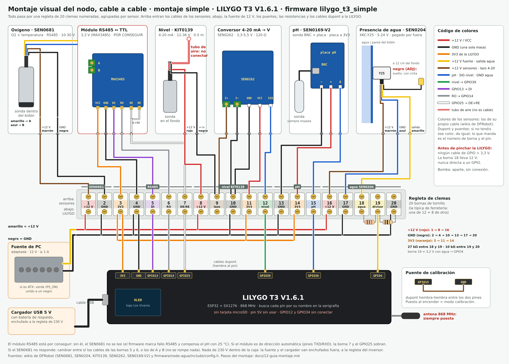

# Guía de montaje paso a paso (montaje simple)

Esta guía explica cómo cablear el nodo **cable a cable**, con los colores reales de cada sensor, la regleta de
clemas numerada y los pines de la LILYGO. Es el montaje que usamos de verdad (`docs/03`, apartado 0): todo se lee
directamente con la LILYGO, sin ADS1115 ni aislador. El firmware es el entorno **`lilygo_t3_simple`**.



(Editable: `img/montaje-visual.svg`. Se vuelve a generar con `python3 img/montaje-visual.py img/montaje-visual.svg`.)

## 1. Antes de empezar

### 1.1. Material

Lo que ya tenemos:

| Qué | Para qué |
|---|---|
| LILYGO T3 V1.6.1 con su antena de 868 MHz | El nodo |
| SEN0681 (oxígeno y temperatura, RS485) | Cable de 4 hilos: marrón, negro, amarillo, azul |
| KIT0139 (nivel 4-20 mA) con su conversor SEN0262 | Cable de la sonda: rojo fino, negro y rojo grueso (tubo de aire) |
| SEN0169-V2 (pH): sonda BNC + placa | Cable Gravity de 3 hilos: rojo, negro, azul |
| SEN0204 (presencia de agua, XKC-Y25) | Cable de 4 hilos: marrón, azul, amarillo, negro |
| Fuente de PC adaptada, 12 V y al menos 1 A | Alimenta los sensores de 12 V |
| Cargador USB de 5 V con batería de respaldo y cable USB de datos | Alimenta la LILYGO |
| Resistencias de 27 kΩ y 10 kΩ | Divisor del SEN0204 |

Lo que falta:

- **Módulo RS485 a TTL de 3,3 V** (MAX3485 o parecido). Está **por conseguir**. Sin él se puede montar y probar
  todo lo demás, pero el SEN0681 no se lee: el firmware marca fallo de RS485 y compensa el pH con 25 °C.
- **Material pequeño de taller** (comprobar que lo hay en el aula antes de empezar): una regleta de clemas
  (la típica de ferretería, hacen falta 20 bornas), cables dupont hembra, cable fino de colores para los puentes,
  cinta aislante, un destornillador pequeño y un polímetro.

### 1.2. Colores de los cables

Los colores de los **sensores** son los de su propio cable y están sacados de las wikis oficiales de DFRobot:

| Sensor | Cable | Función | Fuente |
|---|---|---|---|
| SEN0681 | marrón / negro / amarillo / azul | +V (10-30 V) / GND / RS485 A / RS485 B | wiki DFRobot SEN0681, tabla de pines |
| KIT0139 | rojo fino / negro / rojo grueso | +V (12-36 V) / salida de corriente / **tubo de aire** | wiki DFRobot KIT0139 |
| Conversor SEN0262 | bornas I+ / I− y cable Gravity rojo / negro / azul | entrada y salida del lazo / VCC / GND / señal | wiki DFRobot SEN0262 |
| SEN0169-V2 (placa pH) | cable Gravity rojo / negro / azul | + / − / señal A | conector Gravity analógico |
| SEN0204 | marrón / azul / amarillo / negro | +V (5-24 V) / GND / salida / ADJ (sensibilidad) | wiki DFRobot SEN0204 |
| Fuente ATX | amarillo / negro / verde | +12 V / GND / PS_ON (encendido) | estándar ATX |

Para los **puentes y los dupont** usamos este código (si no tenéis algún color, da igual, lo que manda es el
número de borna y el nombre del pin):

| Color | Uso |
|---|---|
| Rojo | +12 V |
| Negro | GND (masa) |
| Naranja | 3V3 de la LILYGO |
| Morado / gris / blanco | GPIO13 / GPIO14 / GPIO25 (RS485) |
| Verde | GPIO39 (nivel) |
| Azul | GPIO36 (pH) |
| Amarillo | GPIO4 (presencia de agua) |

### 1.3. Reglas de seguridad

1. **Todo desenchufado** mientras se atornilla. La LILYGO, fuera de los cables hasta el paso 9.
2. **Nada de 230 V dentro de la caja**: la fuente de 12 V y el cargador USB se enchufan fuera, en la regleta de 230 V
   que sale del inversor.
3. La LILYGO se alimenta **solo por USB**. El pin 5V no se usa, no se pone tarjeta microSD, y GPIO12 y GPIO34 se
   quedan sin conectar.
4. **Nunca encender la LILYGO sin la antena puesta.**
5. Ningún cable que vaya a un GPIO puede tener más de 3,3 V. La borna 18 lleva 12 V cuando hay agua: **nunca** va
   directa a un pin.
6. La sonda de pH siempre con su capuchón con líquido o metida en agua; si se seca, se estropea.

## 2. Tabla de bornas

Cada borna une lo que entra **por arriba** (cables de los sensores) con lo que sale **por abajo** (puentes,
fuente, resistencias y dupont a la LILYGO). Esta tabla es el resumen de todo el montaje:

| Borna | Nombre | Arriba (sensores) | Abajo (fuente, puentes y LILYGO) |
|---|---|---|---|
| 1 | +12 V | SEN0681 marrón | Fuente amarillo + puente rojo a 8 |
| 2 | GND | SEN0681 negro | Fuente negro + puente negro a 4 |
| 3 | 3V3 | Módulo RS485 VCC | Dupont naranja a **3V3** de la LILYGO + puente naranja a 11 |
| 4 | GND | Módulo RS485 GND | Dupont negro a **GND** de la LILYGO + puentes negros a 2 y 10 |
| 5 | DI | Módulo RS485 DI | Dupont morado a **GPIO13** |
| 6 | RO | Módulo RS485 RO | Dupont gris a **GPIO14** |
| 7 | DE/RE | Módulo RS485 DE y RE (unidos) | Dupont blanco a **GPIO25** |
| 8 | +12 V | KIT0139 rojo fino | Puentes rojos a 1 y 16 |
| 9 | lazo | KIT0139 negro + conversor I+ | — |
| 10 | GND | Conversor I− + conversor GND (negro) | Puentes negros a 4 y 13 |
| 11 | 3V3 | Conversor VCC (rojo) | Puentes naranjas a 3 y 14 |
| 12 | nivel | Conversor SIG (azul) | Dupont verde a **GPIO39** |
| 13 | GND | Placa pH − (negro) | Puentes negros a 10 y 17 |
| 14 | 3V3 | Placa pH + (rojo) | Puente naranja a 11 |
| 15 | pH | Placa pH A (azul) | Dupont azul a **GPIO36** |
| 16 | +12 V | SEN0204 marrón | Puente rojo a 8 |
| 17 | GND | SEN0204 azul | Puentes negros a 13 y 20 |
| 18 | agua (12 V) | SEN0204 amarillo | Resistencia de 27 kΩ a 19 |
| 19 | divisor | — | Resistencia de 27 kΩ (de 18) + resistencia de 10 kΩ (a 20) + dupont amarillo a **GPIO4** |
| 20 | GND | — | Resistencia de 10 kΩ (de 19) + puente negro a 17 |

Aparte: un dupont hembra-hembra entre **GPIO15** y **GND** de la LILYGO, solo cuando se quiera entrar en el modo
calibración.

## 3. Pasos

### Paso 1. Preparar la regleta

1. Cortar una tira de **20 bornas** (por ejemplo una de 12 y otra de 8, puestas en fila).
2. Numerar las bornas del **1 al 20** con rotulador permanente, de izquierda a derecha, y marcar qué lado es
   "arriba" (sensores) y cuál "abajo" (LILYGO).
3. Fijar la regleta a la base de la caja o a una tablilla (tornillos o bridas), para que no se mueva al apretar.
4. Pelar unos 7 mm de cada cable antes de meterlo, y en las bornas donde entran dos cables, retorcerlos juntos
   antes de apretar. Tirar suavemente de cada cable después de apretar: si sale, no estaba bien cogido.

### Paso 2. Puentes de reparto (lado de abajo)

Con trozos de cable fino, unir por abajo las bornas que comparten la misma alimentación:

- **+12 V (rojo):** 1 → 8 → 16
- **GND (negro):** 2 → 4 → 10 → 13 → 17 → 20
- **3V3 (naranja):** 3 → 11 → 14

Así cada sensor tiene su alimentación al lado y no hace falta llevar cables largos de un extremo a otro.
El puente 2 → 4 es el que une la masa de la fuente de 12 V con la masa de la LILYGO (masa común): **no se puede
quitar**, sin él no se leería ningún sensor.

**Comprobación (polímetro en continuidad, todo desenchufado):** 1 con 8 y 16 pita; 2 con 4, 10, 13, 17 y 20 pita;
3 con 11 y 14 pita. Y **no** pita entre 1 y 2, ni entre 3 y 4 (si pita, hay un cortocircuito).

### Paso 3. Fuente de 12 V

1. Si la fuente es de PC tipo ATX y aún no está adaptada, para que arranque sin placa base hay que unir el
   cable **verde** (PS_ON) con un **negro**. Si ya está adaptada (con interruptor o puente hecho), no tocar.
2. Cable **amarillo** (+12 V) → **borna 1**, abajo. Cable **negro** (GND) → **borna 2**, abajo.
3. **Prueba 1:** enchufar la fuente. Con el polímetro en tensión continua, entre las bornas 1 y 2 tiene que marcar
   **12-13 V**, y lo mismo entre 8 y 10 y entre 16 y 17. Desenchufar.

### Paso 4. Presencia de agua (SEN0204)

1. El sensor va pegado **por fuera** del bidón, a unos 12 cm del fondo (`docs/06`, apartado 1.2).
2. Cables por arriba: **marrón → 16**, **azul → 17**, **amarillo → 18**.
3. Cable **negro (ADJ)**: no se conecta. Se le pone cinta aislante en la punta y se deja recogido.
4. Por abajo, las dos resistencias del divisor:
   - **27 kΩ** (colores rojo, violeta, naranja) entre **18 y 19**.
   - **10 kΩ** (colores marrón, negro, naranja) entre **19 y 20**.
5. **Prueba 2:** enchufar la fuente. Medir entre **19 y 20**: con agua a la altura del sensor, unos **3,2 V**; sin
   agua, **0 V**. Si sale más de 3,3 V, revisar las resistencias antes de seguir. Desenchufar.

¿Por qué el divisor? El SEN0204 da en su salida la misma tensión con la que se alimenta (12 V), y el ESP32 solo
aguanta 3,3 V: 12 V × 10 / (27 + 10) ≈ 3,2 V.

### Paso 5. Nivel (KIT0139 + conversor SEN0262)

1. Cable de la sonda por arriba: **rojo fino → 8** (+12 V) y **negro → 9**.
2. El **rojo grueso es el tubo de aire**: no se conecta, no se corta, no se dobla y su punta tiene que quedar al
   aire y seca (fuera del agua y a ser posible dentro de la caja). Sin él, el nivel sale mal.
3. Conversor, bornas de tornillo: **I+ → 9** (junto con el negro de la sonda) e **I− → 10**.
4. Conversor, cable Gravity: **negro → 10**, **rojo → 11**, **azul (SIG) → 12**.
5. Por abajo: **dupont verde de la borna 12 → GPIO39**.

El conversor va a 3V3, así que este sensor no da señal hasta que la LILYGO esté encendida (paso 9).

### Paso 6. pH (SEN0169-V2)

1. Enroscar el BNC de la sonda en la placa del pH.
2. Cable Gravity de la placa, por arriba: **negro (−) → 13**, **rojo (+) → 14**, **azul (A) → 15**.
3. Por abajo: **dupont azul de la borna 15 → GPIO36**.

### Paso 7. Oxígeno (SEN0681) y módulo RS485

Este paso solo se puede hacer cuando tengamos el módulo RS485. Hasta entonces, las bornas 3 a 7 se quedan
preparadas y el SEN0681 sin conectar.

1. SEN0681 por arriba: **marrón → 1** (+12 V) y **negro → 2** (GND).
2. SEN0681 al módulo: **amarillo → A** y **azul → B** (bornas de tornillo del módulo).
3. Módulo por arriba de la regleta: **VCC → 3**, **GND → 4**, **DI → 5**, **RO → 6**.
4. En el módulo, unir **DE con RE** con un trozo de cable y llevar ese punto a la **borna 7**.
5. Por abajo: **5 → GPIO13** (morado), **6 → GPIO14** (gris), **7 → GPIO25** (blanco).

Si el módulo es de los de **dirección automática** (solo tiene TXD y RXD, sin DE ni RE), la borna 7 y el GPIO25
se quedan sin usar.

### Paso 8. Cables a la LILYGO (sin pincharlos todavía)

Por abajo de la regleta salen 8 cables dupont. Se hace con un dupont hembra-hembra cortado por la mitad: la punta
pelada va a la borna y la hembra se pinchará en el pin de la LILYGO.

| Borna | Color | Pin de la LILYGO |
|---|---|---|
| 3 | naranja | 3V3 |
| 4 | negro | GND |
| 5 | morado | GPIO13 |
| 6 | gris | GPIO14 |
| 7 | blanco | GPIO25 |
| 12 | verde | GPIO39 |
| 15 | azul | GPIO36 |
| 19 | amarillo | GPIO4 |

Cada pin se busca por su nombre en la **serigrafía de la placa** (y si hay duda, en el pinout oficial de LilyGO
de la T3 V1.6.1). Etiquetar la punta hembra de cada dupont con un trozo de cinta y el nombre
del pin.

### Paso 9. Comprobaciones y primer encendido

Con la LILYGO **todavía sin pinchar**:

1. Polímetro en continuidad, todo desenchufado: no pita entre 1 y 2 (+12 V y GND) ni entre 3 y 4 (3V3 y GND).
2. Enchufar la fuente de 12 V y medir cada dupont contra GND (borna 4). Ninguno puede pasar de 3,3 V. Lo normal es
   0 V en todos menos el amarillo (GPIO4), que marca unos 3,2 V si hay agua frente al SEN0204. Desenchufar.

Si todo está bien:

3. Poner la **antena** en la LILYGO.
4. Pinchar los 8 dupont en sus pines.
5. Encender en este orden: **primero la LILYGO** (cable USB del cargador) y **después la fuente de 12 V**.
   Para apagar, al revés: primero la fuente y luego la LILYGO. Así nunca llega tensión a un GPIO con el ESP32 apagado.
6. La pantalla tiene que mostrar el logo de Los Viveros y el temporizador del envío.

### Paso 10. Grabar el firmware y comprobar las lecturas

1. Grabar el entorno simple desde el PC (`firmware/nodo-agua`):
   ```
   pio run -e lilygo_t3_simple -t upload
   pio device monitor -b 115200
   ```
2. Poner el **puente de calibración** (dupont hembra-hembra entre GPIO15 y GND) y pulsar el reset de la placa.
   En el monitor serie sale `=== MODO CALIBRACION ===` y espera 60 s a que calienten los sensores.
3. Escribir `leer`. Sale una línea así (ejemplo con todo montado):
   ```
   T=21.50 C  O2=8.90 mg/L  pH=7.20  nivel=180 mm  bat=0 mV  agua=1  rs485_err=0
   ```
   Qué mirar:
   - `pH`: en agua del grifo, entre 6,5 y 8,5 (antes de calibrar puede salir algo desviado).
   - `nivel`: con la sonda fuera del agua, cerca de 0 mm; metida en el bidón, la altura del agua sobre la sonda.
   - `agua`: 1 si hay agua frente al SEN0204 y 0 si no.
   - `rs485_err=1` mientras no esté el módulo RS485 (normal). Con el módulo puesto tiene que salir 0; si sale 1,
     cambiar entre sí los cables de las bornas 5 y 6, y si sigue igual, los de A y B. No se rompe nada.
   - `bat=0 mV` es normal: en este montaje no se mide la batería.
4. Calibrar el pH: sonda en tampón 7 → `ph7`; enjuagar, sonda en tampón 4 → `ph4`. `ver` enseña lo guardado.
5. Ajustar el cero del nivel: con el bidón vacío y la sonda en el fondo, apuntar el `nivel=` y ponerlo en
   `NIVEL_CERO_MM` de `config.h` (`docs/06`, apartado 1.4).
6. `salir`, **quitar el puente de calibración** y pulsar reset. El nodo hace el join y empieza a enviar; los datos
   aparecen en la web a los pocos segundos de cada envío.

### Paso 11. Montaje final

1. Meter las sondas en el bidón de una en una por la boca y sacar sus cables por los agujeros del tapón
   (`docs/06`, apartados 1.2 y 1.3). El KIT0139 apoyado en el fondo; el pH y el SEN0681 a 8-10 cm del fondo.
2. Sujetar los dupont a la LILYGO con una brida o un poco de cinta para que no se suelten con el viento o al
   mover la caja.
3. Dentro de la caja estanca: regleta, LILYGO, conversor, placa del pH y módulo RS485. Fuera: fuente y cargador,
   enchufados a la regleta de 230 V del inversor.
4. La antena, vertical y fuera de la caja si se puede (o con la caja de plástico, nunca dentro de una metálica).

## 4. Problemas típicos

| Qué pasa | Qué mirar |
|---|---|
| No marca 12 V en la borna 1 | La fuente no arranca: puente verde-negro (si es ATX) o el interruptor |
| `agua` siempre 0 | Amarillo del SEN0204 en la 18, resistencias bien puestas, sensibilidad (sensor bien pegado a una pared lisa) |
| `agua` siempre 1 | La resistencia de 10 kΩ no llega a la 20, o el sensor detecta la mano o algo pegado |
| `nivel` raro o negativo | Tubo de aire doblado o mojado; I+ e I− cambiados; masa común (puente 2 → 4) |
| `pH` que baila | Probar a desenchufar la bomba: sin aislador, el pH comparte masa con el resto de sondas (`docs/03`) |
| `rs485_err=1` con el módulo puesto | Cruzar 5 y 6, después A y B; comprobar 3V3 en la borna 3 |
| La LILYGO se reinicia | Cargador USB flojo o cable USB malo; probar con otro |

---
Fuentes: wikis de DFRobot (SEN0681, SEN0204, KIT0139, SEN0262, SEN0169-V2), esquema oficial `T3_V1.6.1.pdf` de
LilyGO y `firmware/nodo-agua/include/config.h` (entorno `lilygo_t3_simple`).
