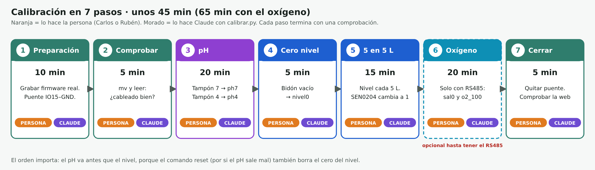
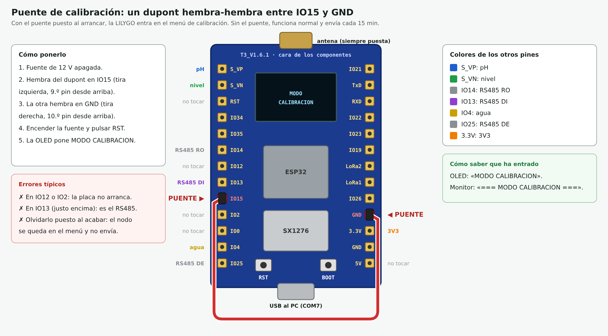
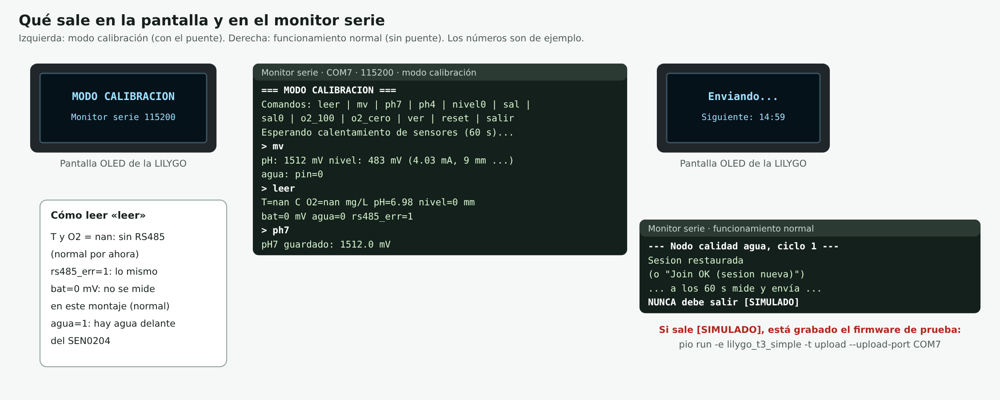
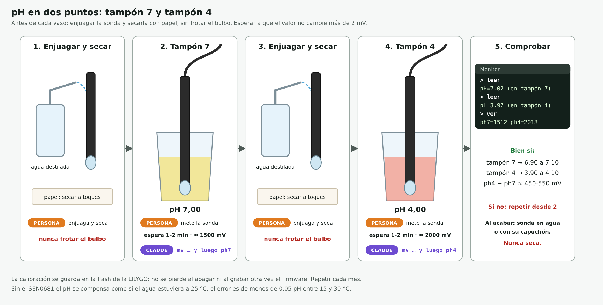
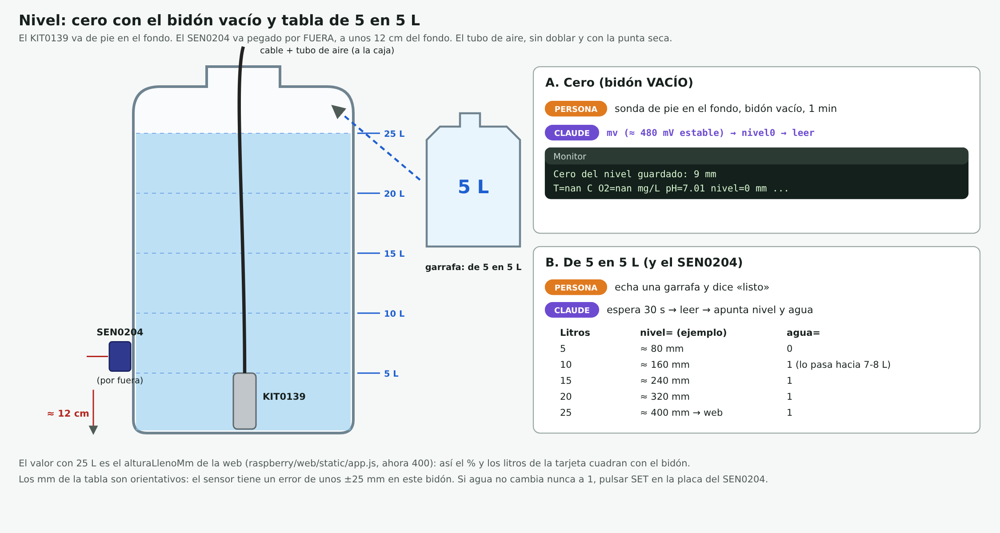
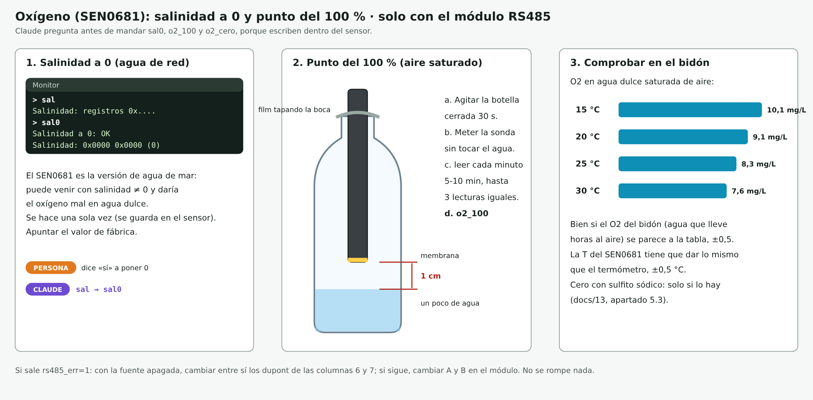

# Checklist de calibración en el taller (persona + Claude)

Esta hoja es para calibrar el nodo **entre dos**: una persona del grupo (Carlos o Rubén) hace la parte física y
**Claude Code**, con la LILYGO conectada por USB al PC, manda los comandos con `herramientas/calibrar.py` y lee los
resultados. La explicación larga de cada sensor está en `docs/13-guia-calibracion.md`; aquí va solo lo que hay que
hacer, en orden, con un dibujo de cada parte. Hay una versión en PDF para imprimir: `docs/14-checklist-calibracion.pdf`.
(Los dibujos se vuelven a generar con `python3 img/calibracion-visual.py img/` y son editables en `img/calib-*.svg`.)

**Tiempo total**: unos 45 min sin el oxígeno (pH 20 min, nivel 15 min, presencia de agua 5 min) y unos 20 min más
con el SEN0681 cuando tengamos el módulo RS485.

**Cómo se trabaja**: en cada paso, la persona hace lo de su columna y escribe en el chat **"listo"**. Claude manda el
comando, enseña lo que sale y dice si está bien o hay que repetir. Claude no guarda nada (`ph7`, `ph4`, `nivel0`)
hasta que la lectura esté estable, y pregunta antes de escribir en el SEN0681 (`sal0`, `o2_100`, `o2_cero`).

## 1. Material (marcar antes de empezar)

| ✔ | Qué | Para qué |
|---|---|---|
| ☐ | PC con PlatformIO, la carpeta `TFG` al día con `main` y Claude Code conectado (Remote Control) | Grabar y mandar los comandos |
| ☐ | Cable USB de **datos** (no solo de carga) | LILYGO ↔ PC, sale como **COM7** |
| ☐ | Montaje de `docs/12` terminado y la **antena** puesta | |
| ☐ | Fuente de 12 V enchufada a la regleta | Alimenta los sensores |
| ☐ | Dupont **hembra-hembra** | Puente de calibración IO15 ↔ GND |
| ☐ | Tampón **pH 7,00** y tampón **pH 4,00** (unos 50 mL de cada uno, en vasos limpios) | pH |
| ☐ | Agua destilada en un frasco lavador (o agua del grifo si no hay) y papel de cocina | Enjuagar la sonda de pH |
| ☐ | Bidón de 25 L **vacío** y una garrafa de 5 L | Nivel |
| ☐ | Unos 25 L de agua del grifo cerca (5 garrafas) | Nivel y presencia de agua |
| ☐ | Termómetro (cualquiera de cocina vale) | Comprobar la temperatura del SEN0681 |
| ☐ | Polímetro | Comprobar tensiones si algo falla |
| ☐ | Botella de plástico de 1,5 L con un poco de agua y film transparente | Oxígeno al 100 % (solo con RS485) |
| ☐ | (Opcional) sulfito sódico anhidro y una báscula | Oxígeno a cero; si no hay, se salta |
| ☐ | Esta hoja impresa y un boli | Apuntar los resultados (apartado 9) |

## 2. Preparación (10 min)

| # | Persona | Claude | Bien si… |
|---|---|---|---|
| 2.1 | Enchufa la LILYGO al PC por USB. Avisa a Claude | Comprueba que el firmware de `main` está en la carpeta y graba `lilygo_t3_simple` en COM7 | Sale `SUCCESS` al grabar |
| 2.2 | — | Abre el monitor 1 min sin puente | Sale `Sesion restaurada` o `Join OK` y **no** `[SIMULADO]` |
| 2.3 | Con la fuente de 12 V **apagada**, pone el puente **IO15 ↔ GND**. Enciende la fuente de 12 V | — | |
| 2.4 | Escribe "listo" | `calibrar.py COM7 mv leer` (reinicia la placa y espera **~2 min**: arranque + 60 s de calentamiento) | La OLED pone `MODO CALIBRACION` y sale el menú de comandos |

Si en el 2.4 no sale el menú: el puente no está bien puesto (tiene que ir a IO15, no a IO12 ni a IO2) o no se ha
grabado `lilygo_t3_simple`. Si dice que el puerto está ocupado, cerrar el monitor serie.

## 3. Comprobación general (5 min)

Con la sonda de pH **en agua del grifo**, la de nivel **fuera del agua** y el bidón vacío.

| # | Persona | Claude | Bien si… |
|---|---|---|---|
| 3.1 | Escribe "listo" | `--sin-reset mv` | pH entre **1300 y 1700 mV** · nivel unos **480 mV** (≈ 4 mA) · `agua: pin=0` |
| 3.2 | — | `--sin-reset leer` | `rs485_err=1` sin módulo RS485 (es normal) · `bat=0 mV` (es normal) |

Si algo no cuadra, se para aquí y se mira la tabla de `docs/13`, apartado 1. No tiene sentido calibrar con un cable
suelto.

## 4. pH con los tampones 7 y 4 (20 min)

| # | Persona | Claude | Espera | Bien si… |
|---|---|---|---|---|
| 4.1 | Quita el capuchón (guarda el líquido). Enjuaga la sonda y sécala **sin frotar el bulbo** | — | | |
| 4.2 | Mete la sonda en el **tampón 7**. "listo" | `mv` cada 30 s | **1-2 min** | El pH deja de moverse (menos de 2 mV entre lecturas). Ronda los **1500 mV** |
| 4.3 | — | `ph7` | | Sale `pH7 guardado: … mV` |
| 4.4 | Saca la sonda, enjuágala y sécala. Métela en el **tampón 4**. "listo" | `mv` cada 30 s | **1-2 min** | Estable y **más alto** que en el 7 (unos 2000 mV) |
| 4.5 | — | `ph4` | | Sale `pH4 guardado: … mV` |
| 4.6 | Enjuaga y vuelve a meterla en el **tampón 7**. "listo" | `leer` | 1 min | `pH=` entre **6,90 y 7,10** |
| 4.7 | Enjuaga y métela en el **tampón 4**. "listo" | `leer` | 1 min | `pH=` entre **3,90 y 4,10** |
| 4.8 | Enjuaga la sonda y déjala en agua o con su capuchón. **Nunca seca** | `ver` y apunta los mV en el apartado 9 | | La diferencia ph4 − ph7 es de **unos 450-550 mV** |

Si el 4.6 o el 4.7 se salen del margen, se repite desde el 4.2. Si se ha guardado mal (por ejemplo, `ph4` con la
sonda en el 7), Claude manda `reset` y se empieza de nuevo el apartado 4. El `reset` también borra el cero del nivel,
así que el pH se calibra **antes** que el nivel.

## 5. Cero del nivel (5 min)

| # | Persona | Claude | Espera | Bien si… |
|---|---|---|---|---|
| 5.1 | Pone el KIT0139 **de pie en el fondo del bidón vacío**, como va a quedar montado. Tubo de aire sin doblar y con la punta seca. "listo" | `mv` dos o tres veces | **1 min** | Nivel estable, unos 480 mV |
| 5.2 | — | `nivel0` | | `Cero del nivel guardado: … mm` (lo normal, entre −50 y 50) |
| 5.3 | — | `leer` | | `nivel=0 mm` |

Se guarda en la flash: no hay que volver a grabar el firmware.

## 6. Tabla de 5 en 5 L y presencia de agua (15 min)

El SEN0204 tiene que estar ya pegado por fuera del bidón, a unos 12 cm del fondo (`docs/06`).

| # | Persona | Claude | Espera | Bien si… |
|---|---|---|---|---|
| 6.1 | Echa **5 L**. "listo" | `leer` | 30 s | `nivel=` sube; `agua=0` (el agua aún no llega al SEN0204) |
| 6.2 | Echa otros 5 L (**10 L**). "listo" | `leer` | 30 s | Sube más o menos lo mismo que en el paso anterior. El agua ya ha pasado el SEN0204 (12 cm ≈ 7-8 L): `agua=1` |
| 6.3 | **15 L**. "listo" | `leer` | 30 s | Igual, `agua=1` |
| 6.4 | **20 L**. "listo" | `leer` | 30 s | `agua=1` |
| 6.5 | **25 L** (lleno). "listo" | `leer` | 30 s | Apunta el `nivel=` de 25 L: es el `alturaLlenoMm` de la web |

- Claude apunta cada `nivel=` en la tabla del apartado 9 y, al acabar, cambia `BIDON.alturaLlenoMm` en
  `raspberry/web/static/app.js` (ahora 400) por el valor de 25 L y lo sube en un PR.
- Si `agua` no cambia nunca a 1: la persona pulsa **SET** en la placa del SEN0204 (cambia la sensibilidad, el LED
  parpadea) y Claude vuelve a mandar `mv`. Si sale **al revés** (1 sin agua), Claude cambia `AGUA_ACTIVO_ALTO` a 0 en
  `src/sensores.cpp` y vuelve a grabar.
- Es normal que cada paso no sea idéntico: el sensor tiene un error de unos ±25 mm en este bidón.

## 7. Oxígeno y temperatura (SEN0681), solo con el módulo RS485 (20 min)

Si todavía no está el módulo RS485, este apartado se salta y se pasa al 8.

| # | Persona | Claude | Espera | Bien si… |
|---|---|---|---|---|
| 7.1 | Conecta el módulo RS485 y el SEN0681 (`docs/12`, paso 5) **con la fuente apagada**. Enciende. Mete la sonda en el bidón. "listo" | `calibrar.py COM7 leer` (con reinicio) | ~2 min | `rs485_err=0` |
| 7.2 | Mide el agua con el termómetro y dice la temperatura | Compara con `T=` | | Diferencia de **±0,5 °C** como mucho |
| 7.3 | — | `sal` | | Apunta lo que trae de fábrica |
| 7.4 | Dice "sí" a poner la salinidad a 0 (agua de red) | `sal0` (solo si no era 0) | | `Salinidad a 0: OK` y la nueva lectura da 0 |
| 7.5 | Pone agua en la botella, la cierra y la **agita 30 s**. Mete la sonda con la membrana a **1 cm por encima del agua**, sin tocarla, y tapa la boca con film. "listo" | `leer` cada minuto | **5-10 min** | El `O2=` sale igual tres veces seguidas |
| 7.6 | Dice "sí" a calibrar el 100 % | `o2_100` | | `Calibracion O2 al 100 %: OK` |
| 7.7 | Vuelve a meter la sonda en el bidón (agua que lleve horas al aire). "listo" | `leer` | 5 min | `O2=` parecido a la tabla de abajo, ±0,5 mg/L |
| 7.8 | (Solo si hay sulfito) Prepara 5 g de sulfito en 95 g de agua y espera **1 hora**. Mete la sonda y remueve. Dice "sí" | `leer` hasta que esté quieto cerca de 0 → `o2_cero` | 1 h + 5 min | `Calibracion O2 a cero: OK`. Enjuagar muy bien la sonda después |

Oxígeno en agua dulce saturada de aire: **10,1 mg/L a 15 °C · 9,1 mg/L a 20 °C · 8,3 mg/L a 25 °C · 7,6 mg/L a 30 °C**.

Si en el 7.1 sale `rs485_err=1`: con la fuente apagada, la persona intercambia los dupont de las columnas 6 y 7
(DI y RO) y se repite; si sigue, intercambia A y B en el módulo. No se rompe nada.

## 8. Cerrar (5 min)

| # | Persona | Claude | Bien si… |
|---|---|---|---|
| 8.1 | — | `ver` y lo apunta en el apartado 9 | `ph7`, `ph4` y `nivel0` son los guardados en los pasos 4 y 5 |
| 8.2 | — | `salir` | Sale `Quitar el puente MODO_CAL y reiniciar` |
| 8.3 | **Quita el puente IO15 ↔ GND** y pulsa **RST** | Abre el monitor 2 min | `Sesion restaurada` o `Join OK` y, a los ~60 s, el envío |
| 8.4 | Abre la web en el móvil: `https://rpi-lora.tailc40e5c.ts.net` | Compara la web con el último `leer` | pH, nivel (en %) y, si hay RS485, O2 y temperatura coinciden |
| 8.5 | — | Pasa los resultados del apartado 9 a `docs/` (anexo de pruebas) y actualiza la memoria del proyecto | |

**Importante**: si el puente se queda puesto, el nodo no envía nunca (se queda en el menú de calibración).

## 9. Hoja de resultados (rellenar a mano o la rellena Claude)

Fecha: ____ / ____ / ________     Hecho por: ______________________ y Claude

| Medida | Valor | ¿Bien? |
|---|---|---|
| pH: mV en tampón 7 (`ph7`) | ________ mV | ☐ |
| pH: mV en tampón 4 (`ph4`) | ________ mV | ☐ |
| pH: diferencia ph4 − ph7 | ________ mV (450-550) | ☐ |
| pH: lectura en tampón 7 después de calibrar | ________ (6,90-7,10) | ☐ |
| pH: lectura en tampón 4 después de calibrar | ________ (3,90-4,10) | ☐ |
| Nivel: cero guardado (`nivel0`) | ________ mm | ☐ |
| Nivel con 5 L | ________ mm | |
| Nivel con 10 L | ________ mm | |
| Nivel con 15 L | ________ mm | |
| Nivel con 20 L | ________ mm | |
| Nivel con 25 L (→ `alturaLlenoMm`) | ________ mm | ☐ |
| SEN0204: litros a los que cambia a `agua=1` | ________ L | ☐ |
| SEN0204: ¿hizo falta tocar SET o `AGUA_ACTIVO_ALTO`? | ________ | |
| SEN0681: temperatura sensor / termómetro | ______ °C / ______ °C | ☐ |
| SEN0681: salinidad de fábrica (`sal`) | ________ | |
| SEN0681: salinidad después de `sal0` | ________ (0) | ☐ |
| SEN0681: O2 en el bidón tras `o2_100` | ________ mg/L a ______ °C | ☐ |
| SEN0681: ¿calibración a cero con sulfito? | sí / no | |
| La web enseña lo mismo que el último `leer` | sí / no | ☐ |

Repetir el pH **cada mes** y el oxígeno **cada tres meses** (wiki del SEN0680). El cero del nivel solo hace falta si
se mueve la sonda o se cambia el bidón.
