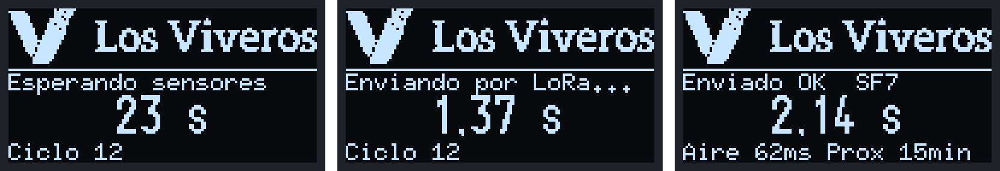

# Firmware del nodo (LILYGO T3 V1.6.1)

Proyecto PlatformIO. Cómo cablearlo: `docs/03-conexionado-nodo.md`. Cómo grabarlo y calibrarlo paso a paso:
`docs/08-guia-instalacion.md` (apartados 1 a 3 y 6).

```
pio run -e lilygo_t3_v1_6_1                 # compilar
pio run -e lilygo_t3_v1_6_1 -t upload       # grabar
pio device monitor                          # monitor serie a 115200
```

### Entornos
| Entorno | Para qué |
|---|---|
| `lilygo_t3_simple` | **Montaje real (2026-11-13)**: todo leído por la LILYGO, sin ADS1115 ni aislador. LILYGO por USB; sensores a 12 V. pH en GPIO36, nivel en GPIO39, presencia de agua en GPIO4 (divisor 27k/10k), caudal en GPIO34 (diodo + pull-up 10k a 3V3), puente de calibración en GPIO15 y DE del RS485 en GPIO25. Esquema: `docs/img/conexionado-simple.png` |
| `lilygo_t3_v1_6_1` | Diseño de `docs/03` (ADS1115, aislador, conmutadores y batería LiFePO4) |
| `lilygo_t3_banco` | LILYGO suelta en la mesa: no mira el pin del puente de calibración |

Los tres hacen el join en SF12 (`LORAWAN_DR_JOIN=0`), porque desde el aula la cobertura va al límite.

Antes de compilar: copiar `include/secrets.example.h` a `include/secrets.h` y poner las claves de ChirpStack
(`secrets.h` no se sube a git).

## Datos simulados (probar la web sin sensores)
El entorno `lilygo_t3_simulado` inventa valores realistas de todos los sensores (`src/simulacion.cpp`) y los envía
cada 2 min con el mismo payload v2. En el monitor serie salen como `[SIMULADO] T=... O2=...`. Uno de cada 12 envíos
lleva el caudal a 0 para probar el aviso "bomba sin caudal". Para volver a lo real basta con grabar otro entorno:
```
pio run -e lilygo_t3_simulado -t upload     # simulación
pio run -e lilygo_t3_banco -t upload        # vuelta a los sensores reales (banco de pruebas)
```

## Qué hace cada ciclo (cada 15 min)
Despierta → enciende sensores → join o sesión guardada → espera 60 s a que se calienten los sensores (los últimos
10 s mide el caudal) → lee sensores → envía 16 bytes por LoRaWAN → enseña el resultado 5 s → deep sleep.
La bomba va aparte, con su propia alimentación: el nodo no la controla (GPIO 12 libre), solo mide su caudal.



## Archivos
| Archivo | Qué hay |
|---|---|
| `platformio.ini` | Placas y librerías (versiones fijas) |
| `include/config.h` | **Todo lo ajustable**: pines, tiempos, caudalímetro, Modbus, ADS1115, pantalla |
| `include/secrets.example.h` | Plantilla de las claves LoRaWAN |
| `include/payload.h` | Formato del mensaje (`docs/04-formato-payload.md`) |
| `src/main.cpp` | Ciclo completo, LoRaWAN (RadioLib) y deep sleep |
| `src/sensores.cpp` | pH, nivel y batería (ADS1115), oxígeno y temperatura (SEN0681 por RS485), caudal y modo calibración |
| `src/pantalla.cpp` | OLED: logo, fase del ciclo y temporizador del envío (tarea de FreeRTOS) |
| `src/i2c_compartido.cpp` | Mutex para que la OLED y el ADS1115 no usen el bus I2C a la vez |
| `include/logo.h` | Logo de Los Viveros en XBM, generado con `herramientas/logo_a_xbm.py` |

Lo que queda por confirmar está marcado con `TODO VERIFICAR` en `config.h` (registros Modbus del SEN0681,
sacados de la wiki del SEN0680 y pendientes de probar con el sensor real, salinidad de fábrica y factor del caudalímetro).
El rango del KIT0139 (0-5 m) ya está confirmado.
