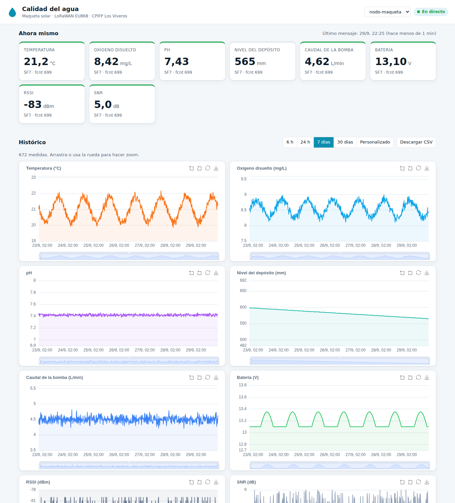

# Puesta en marcha de la Raspberry Pi 5 y del wAP LR8

La Raspberry lo hace todo: servidor LoRaWAN (ChirpStack), MQTT,
base de datos (TimescaleDB) y la web, publicada en Internet con Tailscale Funnel. Red explicada en `docs/02-arquitectura-red.md`.

**Red**: VLAN 500 del instituto, máscara /24, puerta de enlace `172.16.50.1`. wAP LR8 en `172.16.50.2` y
Raspberry en `172.16.50.3`, las dos con IP fija. Los datos están en `red/red.env`; si algo cambia (por
ejemplo el DNS) se cambia ahí y se vuelve a ejecutar el script.

## Instalación automática (recomendada)

`instalar.sh` hace los apartados 1, 2, 3, 5, 6 y 8 de abajo de una vez, incluida el alta en ChirpStack:

1. **Antes**: tener la cuenta de Tailscale del equipo (`docs/09-acceso-internet.md`, apartado 1).
2. Grabar la microSD con **Raspberry Pi Imager** → Raspberry Pi OS Lite (64-bit). En la configuración:
   hostname `rpi-lora`, usuario propio, **SSH con clave pública**, zona horaria Europe/Madrid.
3. Conectar el puerto integrado (eth0) a una toma del switch que esté en la **VLAN 500** (sin etiquetar).
   Lo más cómodo es hacer la instalación con **teclado y monitor**. Si se hace por SSH, al principio la
   Raspberry tendrá una IP del DHCP de la VLAN: el script prepara la IP fija `172.16.50.3`, se para y pide
   reiniciar; después se entra con `ssh usuario@172.16.50.3` y se vuelve a ejecutar `./instalar.sh`
   (lo que ya está hecho se salta). Así nunca se corta la sesión a medias (CLAUDE.md, regla 8).
4. Ejecutar:
   ```bash
   sudo apt update && sudo apt install -y git
   git clone https://github.com/cmaaraver/TFG-2-STI-.git
   cd TFG-2-STI-/raspberry
   ./instalar.sh
   ```
   Solo pregunta el EUI del wAP (si aún no se sabe, Enter) y si está la batería RTC oficial; al final enseña
   un enlace para iniciar sesión en Tailscale. Todo lo demás lo hace solo: sistema, microSD, Docker, red, NTP,
   contraseñas y claves del nodo aleatorias en `.env`, todos los contenedores, **alta en ChirpStack** (contenedor
   `provisionar`: contraseña de admin, gateway, perfil con `decoder.js`, aplicación y nodo), firewall y copia
   diaria. Se puede repetir sin problema.
5. Al terminar enseña la dirección de la web y lo que hay que pedir al coordinador TIC. Queda a mano el
   wAP (apartado 4) y copiar `firmware/nodo-agua/include/secrets.h` (lo genera `provisionar`) al PC con el que
   se graba la LILYGO.
6. `sudo reboot` y comprobar que todo vuelve solo: `sudo docker compose ps`.

## Instalación paso a paso (lo mismo que hace el script)

Cada paso tiene su comprobación; no pasar al siguiente sin que funcione.

## 1. Sistema
1. Raspberry Pi Imager → Raspberry Pi OS Lite (64-bit) → grabar en la **microSD de 64 GB** (mejor una de marca A1/A2
   o de tipo *High Endurance*, que aguantan más escrituras).
   Opciones: hostname `rpi-lora`, usuario propio, SSH con clave pública, zona horaria Europe/Madrid.
2. `sudo apt update && sudo apt full-upgrade -y && sudo apt install -y chrony ufw git`
3. Docker: `curl -fsSL https://get.docker.com | sh && sudo usermod -aG docker $USER` (cerrar sesión y volver a entrar).
4. Cuidar la microSD (lo que más la estropea son las escrituras continuas):
   - Limitar el diario del sistema: en `/etc/systemd/journald.conf` poner `SystemMaxUse=100M` y
     `sudo systemctl restart systemd-journald`.
   - Los registros de los contenedores ya están limitados en `docker-compose.yml` (3 × 10 MB cada uno).
   - Los datos ocupan poco: unos 100 mensajes al día son pocos MB al año, así que no hace falta borrar medidas.
   - Lo importante es tener copia **fuera de la tarjeta** (apartado 8) por si la SD falla.
5. Batería RTC oficial (recargable): añadir `dtparam=rtc_bbat_vchg=3000000` a `/boot/firmware/config.txt`.
   Comprobar: `timedatectl` y `sudo hwclock -r`.
6. `git clone https://github.com/cmaaraver/TFG-2-STI-.git && cd TFG-2-STI-/raspberry`

## 2. Red (con teclado y monitor conectados)
```bash
ip link                                   # comprobar que el puerto integrado se llama eth0
nano red/red.env                          # IP, máscara, puerta de enlace y DNS (VLAN 500)
./red/configurar-red.sh                   # perfil "red-vlan500" con IP fija
sudo cp red/chrony.conf /etc/chrony/chrony.conf && sudo systemctl restart chrony
```
Comprobar: `ip -br a` (172.16.50.3/24 en eth0), `ip route` (default via 172.16.50.1), `ping -c3 172.16.50.1`,
`ping -c3 8.8.8.8`, `getent hosts tailscale.com` (DNS) y `chronyc tracking`.
El firewall se pone al final (paso 6), cuando Docker ya está funcionando.

## 3. Arrancar todo
```bash
cp .env.example .env
nano .env                                  # cambiar TODAS las contraseñas
docker compose up -d --build               # la primera vez tarda (descarga las imágenes)
docker compose ps                          # todo "running"/"healthy"
```
Comprobar:
- `curl http://localhost/api/salud` → `{"estado":"ok"}`.
- Desde un equipo de la VLAN 500: `http://172.16.50.3` → sale la web (sin datos todavía).

## 4. MikroTik wAP LR8 (RouterOS, WinBox o WebFig)
El inyector PoE del wAP va a una toma del switch en la **VLAN 500** (sin etiquetar). Configuración (RouterOS 7, terminal):
```
/ip dhcp-client disable [find]
/ip address add address=172.16.50.2/24 interface=ether1
/ip route add dst-address=0.0.0.0/0 gateway=172.16.50.1
/ip dns set servers=172.16.50.1
/system ntp client set enabled=yes servers=172.16.50.3
```
(Si la configuración de fábrica mete ether1 en un bridge, la IP se pone en el bridge en vez de en ether1:
mirar `/interface bridge port print`. TODO VERIFICAR con el wAP delante.)
- Actualizar RouterOS e instalar el paquete `iot`/`lora` si falta.
- Servidor LoRa: `/iot lora servers add name=chirpstack address=172.16.50.3 up-port=1700 down-port=1700`
  y asignarlo al dispositivo LoRa, red "Public", y activarlo (TODO VERIFICAR comandos en la versión de RouterOS instalada).
- Anotar el Gateway EUI (`/iot lora print`) para darlo de alta en ChirpStack.
- Desactivar la WiFi si no se usa y poner contraseña al usuario `admin` (está en una VLAN compartida).
- Comprobar desde la Raspberry: `ping -c3 172.16.50.2`.

## 5. ChirpStack
1. Tailscale: `curl -fsSL https://tailscale.com/install.sh | sh && sudo tailscale up`
2. Publicar ChirpStack solo para el equipo: `sudo tailscale serve --bg --https=8443 http://127.0.0.1:8080`
   y entrar a `https://rpi-lora.<red>.ts.net:8443` (o con un túnel SSH: `ssh -L 8080:127.0.0.1:8080 rpi-lora`).
3. El alta es automática con el contenedor `provisionar` (lo lanza `instalar.sh`; se puede repetir cuando se quiera):
   ```bash
   sudo docker compose run --rm provisionar
   ```
   Lee del `.env` `CHIRPSTACK_ADMIN_PASSWORD`, `GATEWAY_EUI`, `NODO_DEV_EUI`, `NODO_JOIN_EUI`, `NODO_APP_KEY` y
   `NODO_NWK_KEY`, y deja hecho:
   - Contraseña de `admin` cambiada por la del `.env` (la de fábrica `admin` deja de valer).
   - Gateway `wap-lr8-azotea` con el EUI del wAP → debe salir "online". Si `GATEWAY_EUI` está vacío, se salta:
     poner el EUI en el `.env` y volver a lanzarlo.
   - Perfil `nodo-agua-eu868`: EU868, LoRaWAN 1.1.0, RP002-1.0.3, OTAA, clase A, codec JavaScript = `codec/decoder.js`
     (si se cambia el decoder, basta con volver a lanzar `provisionar`).
   - Aplicación `calidad-agua` y dispositivo `nodo-agua` con sus claves OTAA.
   - `firmware/nodo-agua/include/secrets.h` con esas mismas claves, listo para compilar.
   Salida esperada: `Gateway ... creado`, `Perfil nodo-agua-eu868 creado`, ..., `ChirpStack listo`.
4. Si se prefiere hacerlo a mano: usuario `admin` / contraseña `admin`, cambiarla al entrar y crear lo mismo que la lista de arriba.
5. Comprobar: el nodo hace join, los uplinks salen decodificados en ChirpStack, `docker compose logs ingestor`
   dice "Guardado ..." y la web enseña los valores al momento.

## 6. Firewall
```bash
./red/firewall.sh
```
Comprobar desde otro equipo de la VLAN que la web sigue entrando, y con `sudo iptables -L DOCKER-USER -n -v`
que la regla del UDP 1700 deja pasar solo al wAP (172.16.50.2): el gateway sigue "online" en ChirpStack.

## 7. Acceso desde Internet
El instituto no abre puertos, así que la web sale por Tailscale Funnel (ver `docs/09-acceso-internet.md`):
```bash
sudo tailscale funnel --bg --https=443 http://127.0.0.1:80
sudo tailscale funnel status        # https://rpi-lora.<red>.ts.net (Funnel on)
```
Probar desde un móvil con datos (sin Tailscale): `https://rpi-lora.<red>.ts.net`.
Al coordinador TIC solo hay que pedirle que deje 172.16.50.2 y 172.16.50.3 fuera del DHCP de la VLAN 500.

## 8. Copias de seguridad
`crontab -e` → `0 3 * * * $HOME/TFG-2-STI-/raspberry/backup.sh >> $HOME/backup-agua.log 2>&1`
Guarda las dos bases de datos (medidas y ChirpStack, que tiene las claves de los nodos).
Como todo va en la microSD, las copias hay que sacarlas de la Raspberry: por ejemplo, una vez a la semana
`scp -r rpi-lora:TFG-2-STI-/raspberry/backups/ .` desde un PC, o a un pendrive. Si la tarjeta muere, se graba otra,
se repiten los pasos 1-3 y se restauran las dos copias.
Probar la restauración una vez:
`docker compose exec -T db pg_restore -U agua_admin -d calidad_agua --clean < backups/agua_XXXX.dump`

## Prueba de robustez (para la memoria)
1. `docker compose stop ingestor`
2. Esperar a que el nodo envíe 2 mensajes.
3. `docker compose start ingestor` → en los logs aparecen los 2 mensajes guardados (cola persistente de Mosquitto, QoS 1).
4. `docker compose exec db psql -U agua_admin -d calidad_agua -c "SELECT count(*) FROM medidas;"` antes y después.

## Probar todo el servidor sin hardware (gateway y nodo simulados)
`pruebas/servidor/simular_nodo.py` hace de wAP y de LILYGO: se conecta al Gateway Bridge por UDP 1700, hace el join
OTAA (LoRaWAN 1.1) con las claves del `.env` y manda una medida. Recorre todo el camino real: Gateway Bridge →
ChirpStack (decoder.js) → MQTT → ingestor → TimescaleDB → web.
```bash
pip install cryptography          # una vez
python3 ../pruebas/servidor/simular_nodo.py .env
```
Salida esperada: `Join aceptado`, `Uplink enviado`; luego `docker compose logs ingestor` dice `Guardado <deveui> fcnt=0`
y la web enseña 21,5 °C, 8,3 mg/L, pH 7,2. El gateway del `.env` tiene que estar dado de alta (`provisionar`).

## Probar la web sin el nodo (datos simulados)
Publicar un uplink falso con el mismo formato que ChirpStack:
```bash
docker compose exec -T mosquitto mosquitto_pub -q 1 -t application/1/device/0000000000000001/event/up -m \
'{"deduplicationId":"'$(cat /proc/sys/kernel/random/uuid)'","time":"'$(date -u +%FT%TZ)'",
  "deviceInfo":{"devEui":"0000000000000001","deviceName":"prueba"},"fCnt":1,
  "object":{"temperatura_c":21.5,"oxigeno_mgl":8.1,"ph":7.3,"nivel_mm":600,"bateria_v":13.1,"caudal_lmin":4.5,"agua_presente":true},
  "rxInfo":[{"gatewayId":"0016c001ff000001","rssi":-85,"snr":7.5}],"txInfo":{"modulation":{"lora":{"spreadingFactor":7}}}}'
```
Borrar después los datos de prueba: `DELETE FROM medidas WHERE dev_eui='0000000000000001';` (y en `nodos` y `uplinks_raw`).

## La web



(Captura con **datos simulados** de 7 días, no son medidas reales. En el móvil: `docs/img/web-movil-datos-simulados.png`.)

- `web/app.py`: API (FastAPI). `/api/historico` agrupa en medias automáticamente si hay más de 1500 puntos.
- `web/static/`: la página (HTML + CSS + JavaScript con ECharts, sin depender de Internet).
- Tiempo real: el ingestor inserta → un trigger de la base de datos hace `NOTIFY` → la web lo manda al
  navegador por Server-Sent Events. No hay que recargar la página.
- Los rangos de color de las tarjetas (verde/naranja/rojo) están al principio de `web/static/app.js`.
